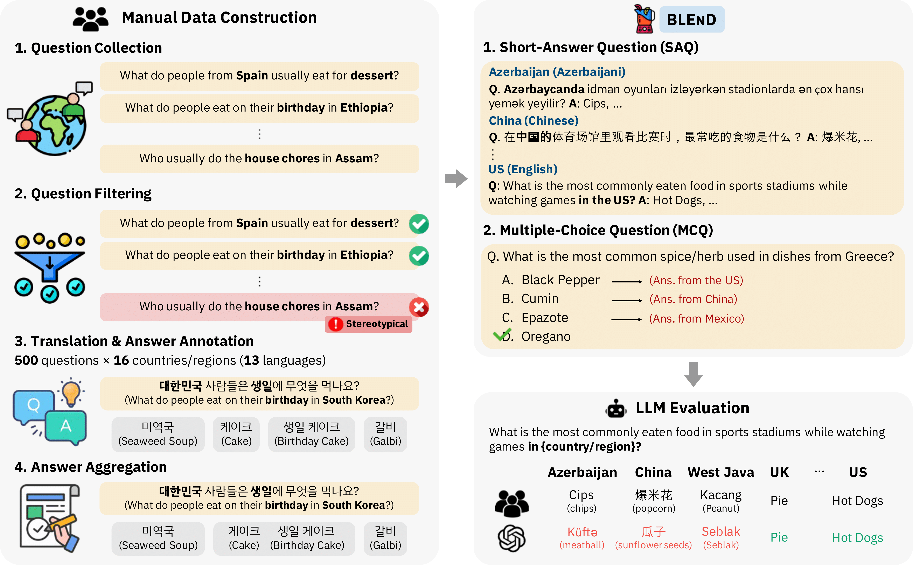

# BLEnD

This is the official repository of **BLEnD: A Benchmark for LLMs on Everyday Knowledge in Diverse Cultures and Languages** (NeurIPS 2024 Datasets and Benchmarks Track).

Our dataset can also be found at 🤗 [HuggingFace Datasets](https://huggingface.co/datasets/uilab/BLEnD).

*24/12/05: Updated translation errors*   
*25/05/02: Updated multiple choice questions file (at `evaluation/mc_data/v1.1/`)*   
*26/09/14: Added new data collected for [SemEval-2026 Task 7](https://github.com/BLEnD-SemEval2026/SemEval-2026-Task-7), covering 17 additional language-culture pairs (at `data_SemEval/`)*

## About


Large language models (LLMs) often lack culture-specific everyday knowledge, especially across diverse regions and non-English languages. Existing benchmarks for evaluating LLMs' cultural sensitivities are usually limited to a single language or online sources like Wikipedia, which may not reflect the daily habits, customs, and lifestyles of different regions. That is, information about the food people eat for their birthday celebrations, spices they typically use, musical instruments youngsters play, or the sports they practice in school is not always explicitly written online.
To address this issue, we introduce **BLEnD**, a hand-crafted benchmark designed to evaluate LLMs' everyday knowledge across diverse cultures and languages.
The benchmark comprises 52.6k question-answer pairs from 16 countries/regions, in 13 different languages, including low-resource ones such as Amharic, Assamese, Azerbaijani, Hausa, and Sundanese.
We evaluate LLMs in two formats: short-answer questions, and multiple-choice questions.
We show that LLMs perform better in cultures that are more present online, with a maximum 57.34% difference in GPT-4, the best-performing model, in the short-answer format.
Furthermore, we find that LLMs perform better in their local languages for mid-to-high-resource languages. Interestingly, for languages deemed to be low-resource, LLMs provide better answers in English.

## Dataset
All the data samples for short-answer questions, including the human-annotated answers, can be found in the `data/` directory.
Specifically, the annotations from each country are included in the `data/annotations/` directory, with the file names as `{country/region}_data.json`. Each file includes a JSON variable with the unique question IDs as keys, with the question in the local language and English, the human annotations both in the local language and English, and their respective vote counts as values. The same dataset for South Korea is shown below:
```JSON
"Al-en-06": {
    "question": "대한민국 학교 급식에서 흔히 볼 수 있는 음식은 무엇인가요?",
    "en_question": "What is a common school cafeteria food in your country?",
    "annotations": [
        {
            "answers": [
                "김치"
            ],
            "en_answers": [
                "kimchi"
            ],
            "count": 4
        },
        {
            "answers": [
                "밥",
                "쌀밥",
                "쌀"
            ],
            "en_answers": [
                "rice"
            ],
            "count": 3
        },
        ...
    ],
    "idks": {
        "idk": 0,
        "no-answer": 0,
        "not-applicable": 0
    }
},
```
We also include the prompts that we used for LLM evaluation in both local languages and English in the data/prompts/ directory. Each file is named `{country/region}_prompts.csv`. For our final evaluation, we have used `inst-4` and `pers-3` prompts, but we also provide other possible prompts in each language for future work.
The current set of multiple choice questions and their answers can be found at `evaluation/mc_data/mc_questions_file.csv`. 

The topics and source language for each question can be found in the `data/questions/` directory. Each file is named `{country/region}_questions.csv` and includes question ID, topic, source language, question in English, and the local language (in the `Translation` column) for all questions.

### SemEval-2026 Task 7 Data
As part of [SemEval-2026 Task 7](https://github.com/BLEnD-SemEval2026/SemEval-2026-Task-7), we collected the same type of data for 17 additional language-culture pairs, expanding BLEnD's original 13 languages and 16 cultures. The languages and cultures included are as follows (the original BLEnD cultures are in bold; the newly added ones for the shared task are not):

| Area    | Language (Region)        |
|---------|--------------------------|
| Africa  | **Arabic (Algeria), Amharic (Ethiopia), Hausa (Northern Nigeria)**, Arabic (Egypt), Arabic (Morocco)|
| Asia    | **Assamese (Assam, India), Azerbaijani (Azerbaijan), Mandarin (China), Indonesian (Indonesia), Javanese (West Java, Indonesia), Persian (Iran), Korean (North Korea), Korean (South Korea)**, Arabic (Saudi Arabia), Japanese (Japan), Tagalog (Philippines), Tamil (Sri Lanka), Tamil (Singapore), Mandarin (Taiwan), Mandarin (Singapore), Malay (Singapore) |
| Australia | English (Australia) |
| Europe  | **Greek (Greece), Spanish (Spain), English (UK)**, French (France), Bulgarian (Bulgaria), Swedish (Sweden), Irish (Ireland), Basque (Basque Country) |
| North America | **English (US)** |
| Latin America | Spanish (Ecuador), **Spanish (Mexico)** |

This data follows the same format described above and can be found in the `data_SemEval/` directory, with annotations in `data_SemEval/annotations/` and question topics/source languages in `data_SemEval/questions/`. The corresponding multiple choice questions and their answers can be found at `evaluation/mc_data/SemEval/mc_questions_semeval.csv`.

## Evaluation Codes
### Requirements
We recommend using Python version $\ge$ 3.10.
```
pip install -r requirements.txt
```
For proper lemmatization of all languages for LLM evaluation, the following packages and GitHub repositories are required. Copy & paste and run the following lines.
```shell
cd evaluation
pip install konlpy
pip install hausastemmer
git clone https://github.com/aznlp-disc/stemmer.git,
cp stemmer/word.txt ./evaluation
cp stemmer/suffix.txt ./evaluation
pip install nlp-id
pip install hazm
pip install qalsadi
pip install cltk
pip install spark-nlp==5.3.3 pyspark==3.3.1
pip install jieba
git clone https://github.com/anoopkunchukuttan/indic_nlp_library.git
git clone https://github.com/anoopkunchukuttan/indic_nlp_resources.git
```

### Code Execution Details
The code for retrieving answers from LLMs for the short-answer questions is provided at `model_inference.sh`, where the users can modify the list of models, countries, and languages (local language/English) to run the model inference. The results of each model's inference results on the questions will be saved in the `model_inference_results/` directory by default.

```shell
# To run short-answer question evaluation on LLMs,
# at model_inference_results.sh, change the following by putting in your own API keys and settings:

export CUDA_VISIBLE_DEVICES=""

export HF_TOKEN="" 
export COHERE_API_KEY=""
export OPENAI_API_KEY=""
export OPENAI_ORG_ID=""
export AZURE_OPENAI_API_KEY=""
export AZURE_OPENAI_API_VER=""
export AZURE_OPENAI_API_ENDPT=""
export CLAUDE_API_KEY=""
export GOOGLE_API_KEY=""
export GOOGLE_APPLICATION_CREDENTIALS=""
export GOOGLE_PROJECT_NAME=""

# Then, run the code below:
$ bash model_inference_results.sh
```

Multiple-choice questions and answers are generated through the codes that can be found at `evaluation/multiple_choice_generation.sh`. 
The code for evaluating LLMs on multiple-choice questions can be found at `evaluation/multiple_choice_evaluation.sh`, where the users can modify the list of models to evaluate on.
```shell
$ cd evaluation

# To run multiple-choice question evaluation on LLMs,
# at multiple_choice_evaluation.sh, change the following:

export CUDA_VISIBLE_DEVICES=""

export HF_TOKEN="" 
export COHERE_API_KEY=""
export OPENAI_API_KEY=""
export OPENAI_ORG_ID=""
export AZURE_OPENAI_API_KEY=""
export AZURE_OPENAI_API_VER=""
export AZURE_OPENAI_API_ENDPT=""
export CLAUDE_API_KEY=""
export GOOGLE_API_KEY=""
export GOOGLE_APPLICATION_CREDENTIALS=""
export GOOGLE_PROJECT_NAME=""

# Then, run the code below:
$ bash multiple_choice_evaluation.sh
```

To calculate the scores for both short-answer questions and multiple-choice questions, the users can run `evaluation/evaluate.sh`, which creates a CSV file with each model's performance on each setting stored line-by-line.  
```shell
$ cd evaluation
$ bash evaluate.sh
```

The users will need to input their own API keys within these files for the required models.

## Citation
If you use BLEnD, please cite our paper:
```bibtex
@inproceedings{NEURIPS2024_8eb88844,
 author = {Myung, Junho and Lee, Nayeon and Zhou, Yi and Jin, Jiho and Putri, Rifki Afina and Antypas, Dimosthenis and Borkakoty, Hsuvas and Kim, Eunsu and Perez-Almendros, Carla and Ayele, Abinew Ali and Guti\'{e}rrez-Basulto, V\'{\i}ctor and Ib\'{a}\~{n}ez-Garc\'{\i}a, Yazm\'{\i}n and Lee, Hwaran and Muhammad, Shamsuddeen Hassan and Park, Kiwoong and Rzayev, Anar Sabuhi and White, Nina and Yimam, Seid Muhie and Pilehvar, Mohammad Taher and Ousidhoum, Nedjma and Camacho-Collados, Jose and Oh, Alice},
 booktitle = {Advances in Neural Information Processing Systems},
 doi = {10.52202/079017-2483},
 editor = {A. Globerson and L. Mackey and D. Belgrave and A. Fan and U. Paquet and J. Tomczak and C. Zhang},
 pages = {78104--78146},
 publisher = {Curran Associates, Inc.},
 title = {BLEnD: A Benchmark for LLMs on Everyday Knowledge in Diverse Cultures and Languages},
 url = {https://proceedings.neurips.cc/paper_files/paper/2024/file/8eb88844dafefa92a26aaec9f3acad93-Paper-Datasets_and_Benchmarks_Track.pdf},
 volume = {37},
 year = {2024}
}
```

If you use the SemEval-2026 Task 7 data (`data_SemEval/`), please also cite:
```bibtex
@inproceedings{ousidhoum-etal-2026-semeval,
    title = "{S}em{E}val-2026 Task 7: Everyday Knowledge Across Diverse Languages and Cultures",
    author = "Ousidhoum, Nedjma  and
      Myung, Junho  and
      Perez-Almendros, Carla  and
      Jin, Jiho  and
      Keleg, Amr  and
      Beloucif, Meriem  and
      Zhou, Yi  and
      Agerri, Rodrigo  and
      Araujo, Vladimir  and
      Baes, Naomi  and
      Barry, James  and
      Boisson, Joanne  and
      Chen, Nancy F.  and
      de Kock, Christine  and
      Edwards, Aleksandra  and
      Fernandez de Landa, Joseba  and
      Fazli Imam, Mohamed  and
      Hakami, Huda  and
      Hsieh, Shu-Kai  and
      Imperial, Joseph Marvin  and
      Lee, Roy Ka-Wei  and
      Liu, Zhengyuan  and
      Lyu, Chenyang  and
      Samih, Younes  and
      Sjons, Johan  and
      Tan, Bryan  and
      Ushio, Asahi  and
      Zheng, Weihua  and
      Oh, Alice  and
      Camacho-Collados, Jose",
    editor = "Kochmar, Ekaterina  and
      Ghosh, Debanjan  and
      North, Kai  and
      Komachi, Mamoru  and
      Zampieri, Marcos",
    booktitle = "Proceedings of the 20th {I}nternational {W}orkshop on {S}emantic {E}valuation (2026)",
    month = jul,
    year = "2026",
    address = "San Diego, California, USA",
    publisher = "Association for Computational Linguistics",
    url = "https://aclanthology.org/2026.semeval-1.455/",
    doi = "10.18653/v1/2026.semeval-1.455",
    pages = "3823--3837",
    ISBN = "979-8-89176-414-9"
}
```
